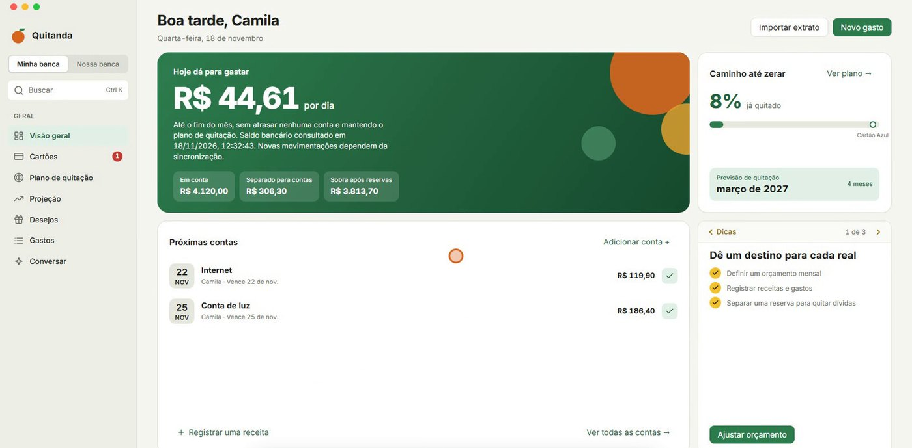
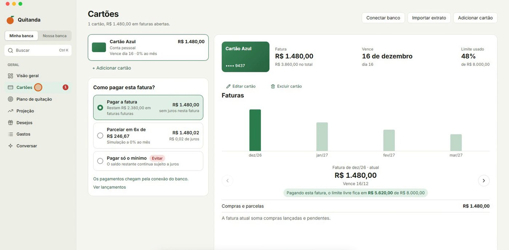
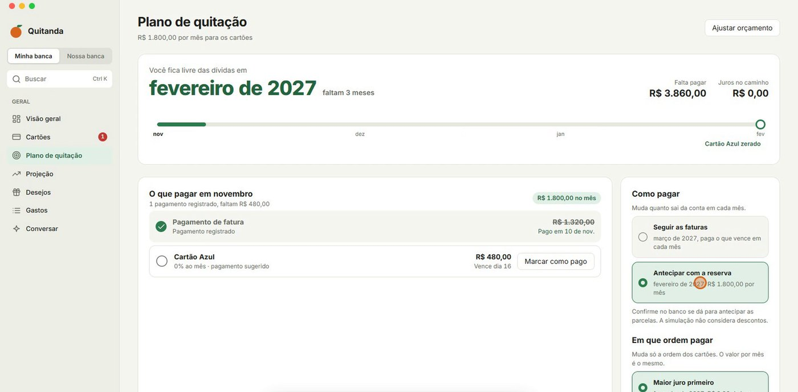
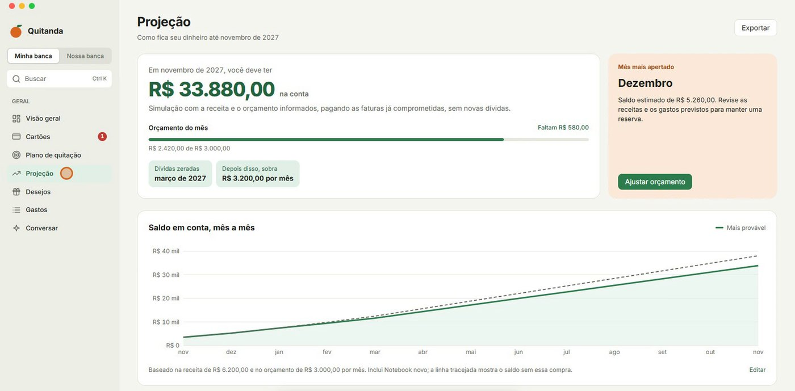
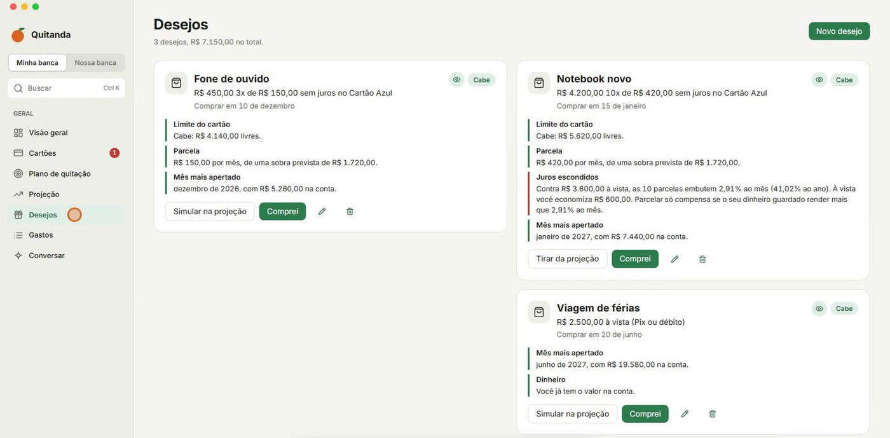
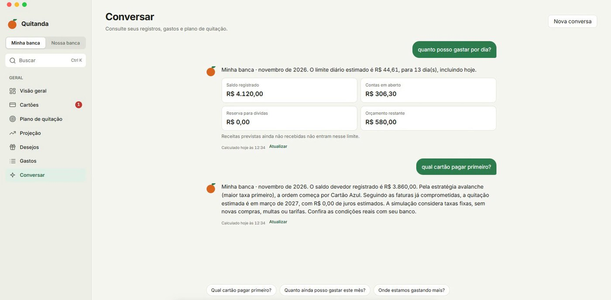
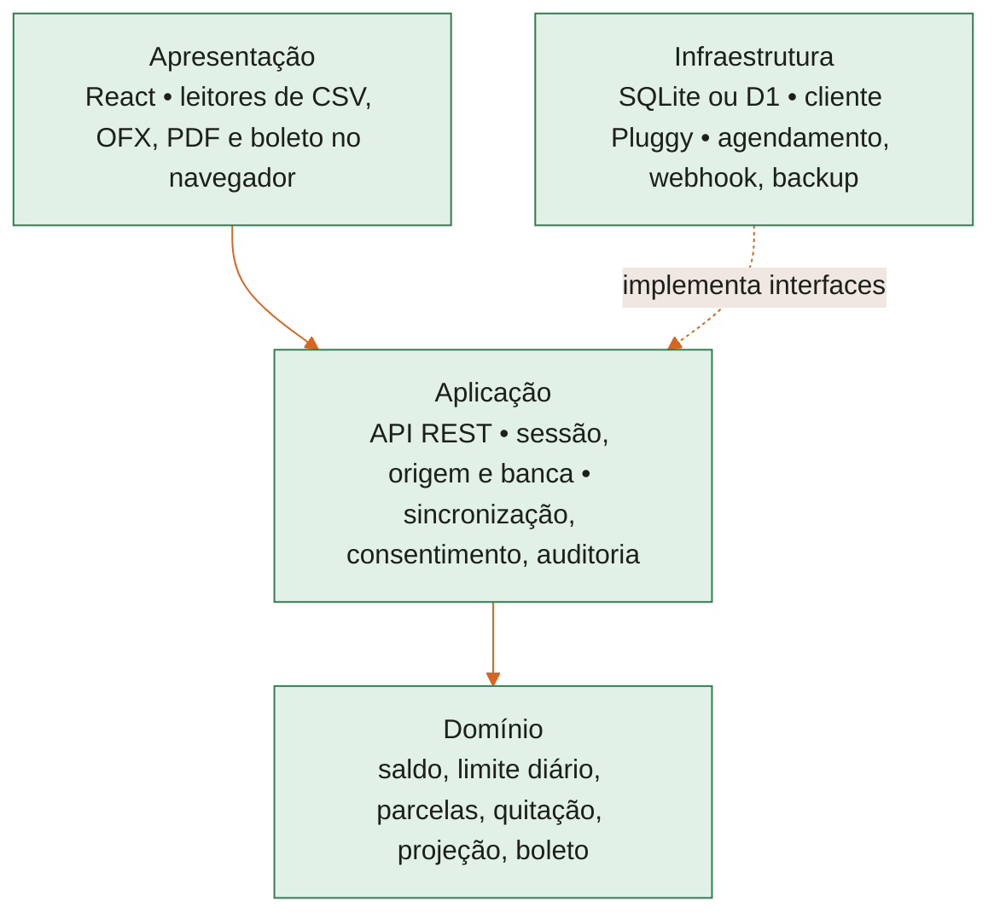
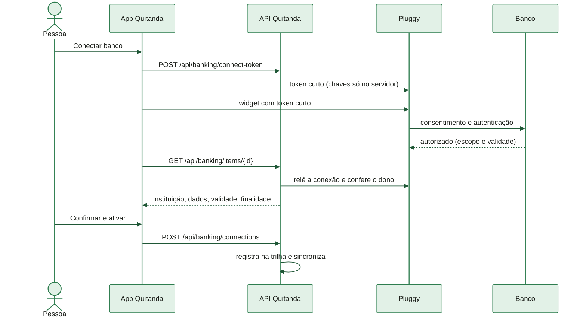
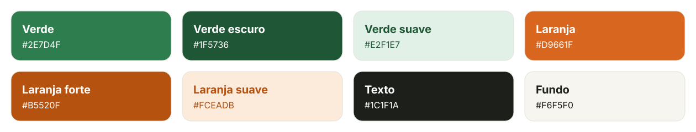

<div align="center">


<br /><br />

[](https://minhaquitanda.com.br)
[](https://demo.minhaquitanda.com.br)


</div>

> **Sobre este repositório:** esta é a página pública do projeto. O código-fonte é privado. O Documento de Arquitetura de Software e o vídeo da demonstração acompanham a entrega da atividade.

| Projeto | |
| --- | --- |
| **Disciplina** | Tecnologia Bancária (ECP6NA) |
| **Professor** | Jefferson Fernando dos Santos Ferreira |
| **Entrega** | MVP final, AP1 do 2º bimestre |
| **Autora** | Camila Félix dos Reis |

## O produto em telas

<sub>Todas as imagens usam dados fictícios.</sub>

| Visão geral | Cartões e faturas |
| --- | --- |
|  |  |
| **Plano de quitação** | **Projeção** |
|  |  |
| **Desejos** | **Conversar** |
|  |  |

## Sumário

1. [Informações do projeto](#1-informações-do-projeto)
2. [Equipe e papéis](#2-equipe-e-papéis)
3. [Planejamento e execução](#3-planejamento-e-execução)
4. [Arquitetura e decisões de projeto](#4-arquitetura-e-decisões-de-projeto)
5. [Lógica de negócio e contratos inteligentes](#5-lógica-de-negócio-e-contratos-inteligentes)
6. [Segurança, LGPD, consentimento e autenticação](#6-segurança-lgpd-consentimento-e-autenticação)
7. [Integração das APIs RESTful com o frontend](#7-integração-das-apis-restful-com-o-frontend)
8. [Riscos, viabilidade técnica e complexidade](#8-riscos-viabilidade-técnica-e-complexidade)
9. [Qualidade e testes](#9-qualidade-e-testes)
10. [Identidade visual](#10-identidade-visual)

### Onde encontrar cada requisito da AP1

| Requisito | Seção |
| --- | --- |
| Nome, problema atacado e conceitos aplicados | [1](#1-informações-do-projeto) |
| Integrantes e distribuição de responsabilidades | [2](#2-equipe-e-papéis) |
| Organização nas quatro fases do guia | [3](#3-planejamento-e-execução) |
| Arquitetura e decisões de projeto | [4](#4-arquitetura-e-decisões-de-projeto) |
| Lógica de negócio, descentralização, DLT e contratos inteligentes | [5](#5-lógica-de-negócio-e-contratos-inteligentes) |
| OAuth2, JWT, LGPD, consentimento e autenticação | [6](#6-segurança-lgpd-consentimento-e-autenticação) |
| Integração das APIs RESTful com o frontend | [7](#7-integração-das-apis-restful-com-o-frontend) |
| Riscos, viabilidade técnica e complexidade do MVP | [8](#8-riscos-viabilidade-técnica-e-complexidade) |

---

## 1. Informações do projeto

### Problema atacado

O sistema financeiro tradicional deixa a informação espalhada. Cada banco mostra só os próprios dados, e o cliente soma saldo, fatura, parcelas e contas a pagar à mão.

No cartão, a mesma compra aparece como compra, como parcela nas faturas seguintes e como pagamento de fatura na conta corrente. Quem soma tudo conta o mesmo dinheiro duas ou três vezes. Para um casal, o problema cresce: parte dos gastos é comum, parte é de cada um, e conta conjunta não é necessária nem desejável para todos.

### Solução

O Quitanda reúne os dados autorizados pelo titular via Open Finance e os registros manuais, calcula saldo e limite diário sem dupla contagem e apoia decisões de pagamento e de compra.

> O aplicativo só lê e registra. Ele não vê a senha bancária, não transfere dinheiro, não paga boletos e não contrata parcelamentos.

### Conceitos aplicados

| Conceito | Como aparece no Quitanda |
| --- | --- |
| **Open Finance** | Pilar desenvolvido, em modo de leitura: contas, saldos, transações, faturas e parcelas do cartão, via agregador Pluggy. |
| **Consentimento do titular** | Autorização no ambiente do banco, confirmação explícita no Quitanda, painel com validade e escopo, revogação e expiração com descarte. |
| **LGPD** | Minimização, segregação por titular, direitos do art. 18 e trilha de auditoria imutável. |
| **APIs RESTful** | API própria em JSON consumida pelo frontend e cliente da API REST da Pluggy no servidor. |
| **Sandbox Regulatório** | Sandbox do agregador para desenvolver e demonstrar; o Sandbox do Banco Central é o caminho para operar como participante. |
| **DREX, tokenização e DLT** | Fora do MVP, com justificativa e contrato de extensão desenhado na [seção 5](#5-lógica-de-negócio-e-contratos-inteligentes). |

### Funcionalidades

| Área | O que oferece |
| --- | --- |
| **Acesso** | Cadastro, login por senha ou biometria (passkeys/WebAuthn), confirmação de e-mail e recuperação de senha por link de uso único. |
| **Bancas** | **Minha banca** privada e **Nossa banca** compartilhada por convite de uso único, válido por sete dias. |
| **Open Finance** | Conexão com confirmação explícita, painel de consentimentos, histórico de acessos e desconexão com opção de apagar os dados importados. |
| **Cartões** | Fatura aberta, faturas futuras pelas parcelas restantes, compras pendentes e estornos. |
| **Visão geral** | Saldo, limite diário estimado, reservas de contas e de dívidas. |
| **Contas a pagar** | Preenchimento pela linha digitável ou pelo PDF do boleto, lidos no navegador, com baixa automática quando o débito aparece no banco. |
| **Plano de quitação** | Seguir as faturas ou antecipar com a reserva, em ordem de maior juro ou menor dívida. |
| **Projeção** | Saldo mês a mês por 12 meses, com cenários e com os Desejos simulados. |
| **Desejos** | "Cabe", "Cabe, mas aperta" ou "Não cabe ainda", com os juros embutidos no parcelado "sem juros". |
| **Conversar** | Respostas por regras sobre os próprios números e ajuda com busca BM25, sem modelo de linguagem e sem enviar dados a outro serviço. |
| **Importação** | Extratos OFX de qualquer banco, PDF do Nubank e CSV, com prévia e sem duplicar lançamentos. |
| **Seus dados** | Exportação em JSON e exclusão da conta pela própria interface. |

## 2. Equipe e papéis

Projeto individual. Todos os papéis foram exercidos por **Camila Félix dos Reis**.

| Papel | Responsabilidade no projeto |
| --- | --- |
| **Analista de Ecossistema** | Escolha do agregador, mapeamento das instituições alcançáveis, modelo de negócio e posicionamento frente a concorrentes. |
| **Guardiã de Dados** | Mapa LGPD, ciclo de vida do consentimento, trilha de auditoria, exclusão de conta, política de privacidade e termos de uso. |
| **Arquiteta de lógica de negócio e DLT** | Domínio financeiro compartilhado, regras sem dupla contagem e avaliação de DLT e contratos inteligentes. |
| **Integradora** | API REST, cliente Pluggy, sincronização, webhook, frontend web e implantação em servidor próprio. |

## 3. Planejamento e execução

O trabalho seguiu as quatro fases do guia inicial, com desenvolvimento incremental e commits em conventional commits.

| Fase | Pesquisa | Entrega |
| --- | --- | --- |
| **1. Ecossistema** | Participação direta no Open Finance exige autorização regulatória; escolha da Pluggy pelo widget, catálogo, API única e Sandbox. | Cliente Pluggy, token curto de conexão e validação de ambiente do conector. |
| **2. Segurança** | Mapa LGPD, modelo de ameaças, comparação entre sessão opaca e JWT, OAuth2/PKCE no perímetro do agregador. | Sessão revogável, passkeys, checagem de origem, limites de tentativa, isolamento por dono e banca, trilha imutável. |
| **3. Blockchain** | Avaliação de DREX, tokenização e DLT frente ao problema do MVP. | Decisão registrada de não usar DLT no MVP e desenho do contrato de ancoragem. |
| **4. Integração** | Contrato da API do provedor: paginação por cursor, conexão, validade e escopo do consentimento. | Sincronização tudo ou nada, expiração, revogação, webhook, agendamento e frontend. |

## 4. Arquitetura e decisões de projeto

### Camadas



**As regras ficam isoladas da infraestrutura.** O domínio em `app/shared` não conhece HTTP, SQL, variáveis de ambiente nem provedor. As mesmas regras rodam na API e nas telas, e a mesma API roda em Node com SQLite ou em Cloudflare Workers com D1, por um adaptador de banco.

### Tecnologias

| Camada | Tecnologias |
| --- | --- |
| **Frontend** | React 19, TypeScript, Vite, Tailwind CSS, React Aria, Recharts |
| **API** | TypeScript, Node.js 24 com SQLite ou Cloudflare Workers com D1 |
| **Integrações** | Pluggy (REST e widget), SimpleWebAuthn, PDF.js, Resend |
| **Qualidade** | Node Test Runner, Playwright, oxlint, Prettier |
| **Implantação** | Servidor próprio com HTTPS, serviço isolado por instância, migrações e backups |

### Principais decisões

| Decisão | Alternativa descartada | Motivo |
| --- | --- | --- |
| Pluggy como agregador | Integrar banco a banco | Participar diretamente do Open Finance exige autorização do Banco Central. |
| Sessão opaca e revogável | JWT de curta duração | O token é encerrado na hora; um JWT continua válido até expirar. |
| Confirmação no Quitanda além do banco | Confiar só na autorização do banco | A pessoa vê o que será lido, por quanto tempo e para quê antes de qualquer importação. |
| Trilha protegida no banco de dados | Proteção só no código | O banco recusa alteração e exclusão; um erro na aplicação não reescreve o histórico. |
| Sincronização tudo ou nada | Gravar conta a conta | Falha no meio não deixa dados pela metade. |
| Duas formas de pagar, com faturas como padrão | Só dividir a dívida pela reserva | O total inclui as parcelas futuras, mas o dinheiro sai conforme o calendário das faturas. |
| Arquivos lidos no navegador | Upload ao servidor | Menos dado sensível no servidor e nenhum arquivo armazenado. |
| Servidor próprio | Só plataforma gerenciada | Dados e operação sob controle próprio, com Cloudflare mantida como alternativa. |

Os diagramas UML de componentes, implantação, sequência, estados e entidades estão no DAS entregue com o projeto.

## 5. Lógica de negócio e contratos inteligentes

### Regras financeiras

| Tema | Regra |
| --- | --- |
| **Valores** | Dinheiro em centavos inteiros; taxas em centésimos de ponto percentual. |
| **Saldo** | Com banco conectado, usa o saldo informado pelo banco, mais o saldo inicial manual e os lançamentos manuais da conta. Sem banco, usa saldo inicial, receitas e despesas da conta até hoje. |
| **Receita** | Dinheiro recebido na conta, inclusive por Pix e transferência. Resgates e movimentações internas não contam. A receita mensal prevista só alimenta projeções. |
| **Compras no cartão** | Entram no orçamento na compra e só saem do saldo quando a fatura é paga. |
| **Parcelas** | A parcela 1 entra no orçamento do mês; da 2 em diante já faz parte da dívida do cartão. |
| **Estornos** | Abatem o gasto na categoria da compra e não são receita. Crédito de parcelamento não é receita nem estorno. |
| **Pagamento de dívida** | Só o que saiu da conta abate a reserva. Parcela lançada no cartão não é pagamento. |
| **Investimentos** | Aplicar em CDB, RDB ou caixinha não é gasto, e resgatar não é receita. |
| **Limite diário** | Respeita saldo após reservas, orçamento restante e dias restantes do mês. |
| **Contas a pagar** | Pagar gera o gasto e remove a reserva na mesma transação. A baixa automática ocorre com débito de mesmo valor até 15 dias do vencimento. |
| **Desejos** | Folga abaixo de R$ 200,00 no mês mais apertado recebe "Cabe, mas aperta". Compra futura considera o limite liberado pelo plano. |

### Formas de pagar as dívidas

| | **Seguir as faturas** (padrão) | **Antecipar com a reserva** |
| --- | --- | --- |
| **Saída mensal** | O que já está comprometido em cada fatura | A reserva mensal inteira |
| **Sobra da reserva** | Vai só para dívida fora das faturas | Reduz o saldo devedor |
| **Juros simulados** | Só sobre a dívida fora das faturas | Sobre o saldo, pela taxa cadastrada |
| **Quando usar** | Ver o caixa real se pagar só as faturas | Avaliar uma antecipação, que depende do banco |

Plano, projeção, Desejos e limite diário usam a forma escolhida. A simulação vai até 360 meses e não inclui novas compras, tarifas, multas, mínimos nem descontos de antecipação.

### Descentralização e DLT

O MVP **não usa blockchain nem contratos inteligentes**, por decisão de projeto:

1. **Natureza do problema.** O Quitanda lê e calcula dados já registrados pelos bancos. Não há transferência de valor, liquidação nem ativo a tokenizar, que é onde DREX e tokenização agregam.
2. **Origem da confiança.** O dado vem da instituição detentora e do consentimento do Open Finance, arranjo regulado pelo Banco Central. Uma DLT não aumentaria essa confiança.
3. **LGPD.** Gravar dado pessoal financeiro numa cadeia imutável conflitaria com o direito de eliminação do art. 18.

O requisito mais próximo de uma DLT é a **trilha de auditoria imutável**. Com iniciação de pagamento no futuro, a liquidação via DREX seria o caminho natural.

### Contrato previsto

> **Desenho, não implementado.** Nenhum contrato foi escrito, compilado ou implantado no MVP.

| Elemento | Desenho previsto |
| --- | --- |
| **Rede** | Permissionada e compatível com EVM, como Hyperledger Besu. |
| **Fora da cadeia** | Rotina diária lê `audit_events`, calcula o HMAC-SHA-256 de cada registro, com chave fora do banco, e monta a árvore de Merkle. |
| **Na cadeia** | Somente período, raiz, quantidade de eventos e data do registro. |
| **Verificação** | Recalcular a raiz a partir da trilha; divergência indica histórico alterado e gera alerta. |
| **Isolamento** | Interface na aplicação e adaptador na infraestrutura. As regras financeiras não mudam, e falha da rede não bloqueia o aplicativo. |

```solidity
interface IAncoraAuditoria {
    event AncoraRegistrada(uint32 indexed periodo, bytes32 raiz, uint32 eventos);

    /// Restrita ao papel de ancorador; recusa período já registrado.
    function registrar(uint32 periodo, bytes32 raiz, uint32 eventos) external;

    function consultar(uint32 periodo)
        external
        view
        returns (bytes32 raiz, uint32 eventos, uint64 registradoEm);
}
```

## 6. Segurança, LGPD, consentimento e autenticação

### Fluxo de consentimento



Conexão criada para outro login é registrada como acesso negado. Recusar na confirmação revoga o consentimento sem importar nada. Ao reconectar uma instituição, o sistema continua as mesmas contas, sem duplicar saldo, cartão ou lançamentos.

### Autenticação

| Tema | Decisão |
| --- | --- |
| **OAuth2 com PKCE** | Executado pelo agregador com a instituição; o Quitanda nunca recebe a senha bancária. Na participação direta, passa ao Quitanda no perfil FAPI. |
| **JWT** | Não é usado na sessão. Na participação direta, JWS e tokens das instituições entram no perímetro do Quitanda. |
| **Sessão** | Token opaco em cookie `HttpOnly` e `SameSite=Lax`, com só o hash no banco; 12 horas sem uso e teto de 7 dias. |
| **Passkeys** | WebAuthn com desafio de uso único; a chave privada nunca sai do aparelho. |
| **Senhas** | scrypt com N=16384, r=8 e p=5. |
| **Proteções da API** | Checagem de origem, limites de tentativa e webhook autenticado por segredo. |

### LGPD

| Exigência | Implementação |
| --- | --- |
| **Base legal e finalidade** | Consentimento do titular; dados usados só nos cálculos da própria pessoa. |
| **Minimização** | Sem senha bancária, número completo de cartão ou CVV; arquivos lidos no navegador. |
| **Transparência** | Painel de consentimentos e Histórico de acessos. |
| **Revogação e retenção** | Desconectar revoga no provedor; vencido o consentimento, os dados da conexão são apagados por padrão. |
| **Direitos do titular** | Acesso pelo painel, portabilidade em JSON e eliminação pela exclusão de conta. |
| **Segregação** | Conexões sempre pessoais; consultas filtradas por dono ou pela banca do login. |
| **Rastreabilidade** | Trilha imutável de concessão, consulta, revogação, vencimento, apagamento e tentativa negada, sem valores. |

Política de privacidade e termos de uso públicos em [`/#/privacidade`](https://minhaquitanda.com.br/#/privacidade) e [`/#/termos`](https://minhaquitanda.com.br/#/termos).

## 7. Integração das APIs RESTful com o frontend

O frontend consome a API própria em JSON, autenticada por cookie de sessão. A API consome a Pluggy com as credenciais guardadas no servidor, e o navegador recebe apenas um token curto para abrir o widget.

| Verbo | Recurso | Função |
| --- | --- | --- |
| `POST` | `/api/auth/register`, `/api/auth/login` | Cria conta ou entra com senha. |
| `POST` | `/api/passkeys/login/options`, `/verify` | Login por passkey. |
| `GET` | `/api/state` | Estado do mês da banca: saldo, contas, cartões e plano. |
| `PATCH` | `/api/settings` | Receita, orçamento, reserva, estratégia e forma de pagar. |
| `POST` | `/api/banking/connect-token` | Token curto para o widget. |
| `GET` | `/api/banking/items/{id}` | Dados da tela de confirmação. |
| `POST` | `/api/banking/items/{id}/reject` | Recusa e revoga o consentimento. |
| `POST`, `GET` | `/api/banking/connections` | Ativa a conexão ou lista validade e escopo. |
| `POST` | `/api/banking/connections/{id}/sync` | Sincroniza sob demanda. |
| `DELETE` | `/api/banking/connections/{id}` | Revoga, com opção de apagar os dados importados. |
| `GET` | `/api/banking/audit` | Histórico de acessos. |
| `POST` | `/api/banking/webhook` | Aviso autenticado do provedor. |
| `GET`, `POST`, `DELETE` | `/api/messages` | Histórico, pergunta e nova conversa no Conversar. |
| `GET` | `/api/export` | Exporta a banca em JSON. |
| `POST` | `/api/account/delete` | Exclui a conta, revogando as conexões antes. |

Erros usam código HTTP e corpo JSON padronizado: 400, 401, 403, 409, 413, 422, 429 e 502. O contrato completo está no DAS.

## 8. Riscos, viabilidade técnica e complexidade

### Riscos

| Risco | Mitigação |
| --- | --- |
| Bancos reais dependem do contrato de produção com o agregador | Piloto com Sandbox e MeuPluggy; servidor preparado para Open Finance regulado. |
| Limites do provedor: 120 dias e 500 transações por sincronização | Nada é aplicado acima do limite; histórico antigo entra por extrato. |
| Provedor indisponível | Importação manual por CSV, OFX e PDF. |
| Cifragem em repouso ainda não implantada | Dados reais pelo MeuPluggy só para e-mails autorizados, até a migração com volume cifrado e chave externa. |

### Complexidade

| Frente | Nível | Por quê |
| --- | --- | --- |
| Sincronização do cartão | Alta | Fatura, parcelas, pendentes, estornos e pagamentos têm convenções próprias. |
| Concorrência e atomicidade | Alta | Sincronização, webhook e desconexão podem coincidir. |
| Isolamento entre bancas | Média | Toda consulta respeita dono e espaço. |
| Consentimento e auditoria | Média | Confirmação, vencimento, revogação, descarte e registro acontecem juntos. |
| Passkeys | Média | Domínio, origem e desafio precisam bater. |

### Viabilidade

O MVP foi viabilizado pelo Sandbox do agregador, pelo escopo só de leitura, pela implantação única com migrações, agendamento e backup, e por bibliotecas consolidadas como SimpleWebAuthn, PDF.js e o widget oficial da Pluggy.

## 9. Qualidade e testes

| Verificação | Situação |
| --- | --- |
| Testes automatizados | 113 no total: 112 aprovados e 1 opcional, que depende de um extrato real |
| Cenários de navegador | 24 cenários declarados |
| Roteiro manual | QA-01 a QA-14 no DAS |

### Teste de carga

Executado em instância isolada, com 500 pessoas e 500 mil lançamentos fictícios. A carga mistura leituras do mês, histórico, conexões, mensagens e 10% de novos lançamentos.

| Requisições por segundo | p50 | p95 | p99 | CPU (1 núcleo) | RAM | Erros |
| ---: | ---: | ---: | ---: | ---: | ---: | ---: |
| 10 | 26 ms | 53 ms | 67 ms | 6% | 74 MB | 0% |
| 25 | 22 ms | 128 ms | 240 ms | 14% | 77 MB | 0% |
| 50 | 21 ms | **176 ms** | 274 ms | 21% | 85 MB | 0% |
| 100 | 64 ms | 697 ms | 873 ms | 38% | 116 MB | 0% |
| 150 | 1.353 ms | 8.237 ms | 10.523 ms | 44% | 135 MB | 6,7% |

A meta de 500 ms no p95 foi atendida até **50 requisições por segundo**. O teste encontrou uma consulta sem o índice adequado: antes da correção, o p95 chegava a 8,8 s com 10 requisições por segundo. O próximo limite é a escrita em disco. Os resultados vêm de um Ryzen 7 7435HS com 16 GB, com cliente e servidor na mesma máquina, e ainda precisam ser repetidos no servidor de produção.

## 10. Identidade visual



| Elemento | Uso |
| --- | --- |
| **Fruta** | Símbolo da marca: uma laranja com folha verde, ligada à ideia de banca e de escolha no dia a dia. |
| **Verde** | Confiança, ações principais e situação positiva. |
| **Laranja** | Destaque, atenção e chamada para decisão. |
| **Tipografia** | Inter, com números grandes para responder rápido quanto cabe no mês. |

---

<div align="center">


**Quitanda** · Projeto acadêmico de Camila Félix dos Reis

<sub>Todos os direitos reservados.</sub>
</div>
